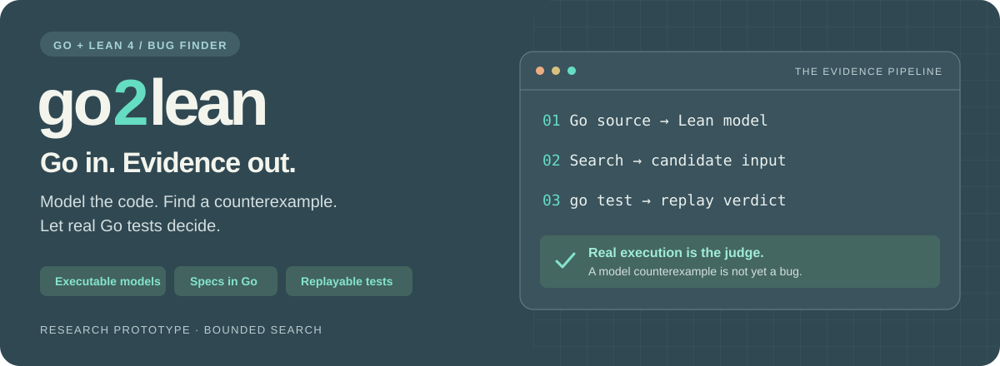
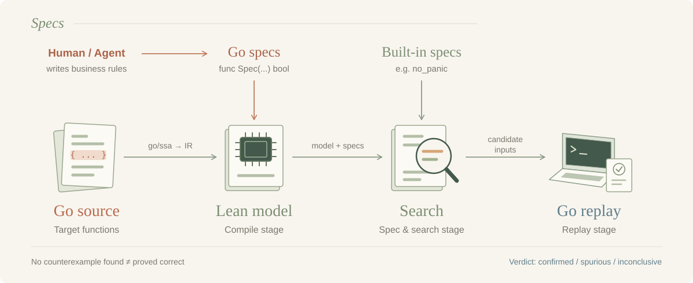

<h1 align="center">go2lean</h1>

<p align="center">
  <a href="#quick-start">Quick Start</a> ·
  <a href="#features">Features</a> ·
  <a href="#how-it-works">How It Works</a> ·
  <a href="#writing-a-spec">Writing a Spec</a> ·
  <a href="#documentation">Documentation</a>
</p>

<p align="center">
  
  
  
  <a href="LICENSE"></a>
</p>

Find bugs in Go functions by translating them into an executable semantic
model in Lean 4, searching that model for counterexamples, and verifying every
counterexample with the real Go toolchain. Built-in templates provide safety
properties; humans or an optional LLM agent write business specs in Go.
Lean finds the inputs; `go test` is the judge.


> **Research prototype.** A bounded, search-based bug finder—not a guarantee of
> correctness. See [limitations](docs/limitations.md) and
> [validation](docs/validation.md) for scope and evidence.

## Features

- **Executable Go models in Lean 4** — translate Go through SSA into a
  fuel-bounded semantic model, with unsupported behavior made explicit.
- **Safety checks without handwritten specs** — automatically generate
  `no_panic` properties for eligible target functions.
- **Business rules written in Go** — express postconditions as ordinary
  `bool`-returning Go functions; compile them alongside the target and reuse
  them as oracles in real Go tests.
- **Counterexample search** — combine seeded random search guided by program
  constants with exhaustive enumeration of small domains; check sequence
  properties over bounded streams of calls.
- **Real Go replay** — turn candidate counterexamples into runnable tests and
  distinguish confirmed findings from spurious or inconclusive results.
- **Optional spec-writing agent** — read source, propose and repair Go specs,
  run the pipeline, and report the verdicts. The basic pipeline needs no API key.

## Quick start

Requires **Git, Go 1.26 and [elan](https://github.com/leanprover/elan)**.
The pinned Lean toolchain is fetched on the first build. No LLM API key is needed.

```sh
git clone https://github.com/andreasfoo/go2lean.git
cd go2lean
go run ./cmd/go2lean run ./examples/overflow
```

The example checks that adding non-negative integers produces a non-negative
result. It finds an overflow counterexample, replays it in Go, and writes a
runnable test plus reproduction instructions to `out/poc/`.

**Run against a scratch clone:** replay executes real code and may have side
effects. On Linux, [bubblewrap](https://github.com/containers/bubblewrap) is
recommended for isolation; without it, replay uses resource limits only.

See the [usage guide](docs/usage.md) for sample output, agent setup, command
options, and running against another module.

## How it works



1. **Compile stage** — translate Go source and optional Go specs into an
   executable Lean model.
2. **Spec & search stage** — check built-in safety properties and business
   specs, using seeded random search and small-domain exhaustive search.
3. **Replay stage** — run candidate inputs with `go test` and report
   **confirmed**, **spurious**, or **inconclusive**, with replayable test artifacts.

No counterexample found does **not** mean proved correct. The optional agent
writes Go specs; it does not replace model search or real Go verification.
[Pipeline details and proof boundaries →](docs/pipeline.md)

## Writing a spec

Built-in `no_panic` checks need no spec code. For a business rule, write an
ordinary Go function in the target package—yourself or with the agent:

```go
// go2lean:spec Sum
func SpecSum(xs []int, ret int) bool {
    for _, x := range xs {
        if x < 0 {
            return true // This rule only constrains non-negative inputs.
        }
    }
    return ret >= 0
}
```

The annotation associates the spec with `Sum`; its arguments are the target's
inputs followed by its result. Returning `false` violates the rule. The same
spec is compiled into Lean and checked again in Go during replay.

Why a business spec? Integer overflow wraps without panicking, so `no_panic`
alone would miss it. [More about specs →](docs/pipeline.md#writing-a-spec)

## Validation

The project checks known-bug examples, compares model behavior with real Go,
and records real-world case studies. CI pins expected regression outcomes;
these checks are evidence, not a general correctness guarantee.

[Validation and regression cases](docs/validation.md) ·
[semver evaluation](docs/eval/semver.md) · [glob evaluation](docs/eval/glob.md)

## Documentation

| Topic | Details |
|---|---|
| [Usage guide](docs/usage.md) | Agent setup, commands, real modules, C / LLVM |
| [Pipeline & specs](docs/pipeline.md) | Model construction, search, replay, spec examples |
| [Go support](docs/reference.md#supported-go-subset) | Supported constructs and library models |
| [Semantics](docs/semantics.md) | How faithfully the model follows Go |
| [Limitations](docs/limitations.md) | Unsupported behavior and trust boundaries |
| [Validation](docs/validation.md) | Regression cases, reproducibility, evaluation evidence |
| [Project reference](docs/reference.md) | Repository layout and roadmap |
| [Design](docs/design.md) | Architecture and technical decisions |
| [Concurrency](docs/concurrency.md) | Concurrent Go modeling and its limits |
| [Related work](docs/related-work.md) | Context and comparisons |

## License

MIT, see [LICENSE](LICENSE).
